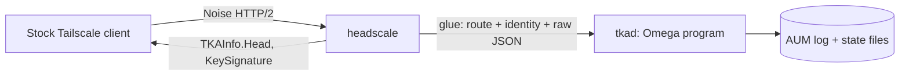

# Tailnet Lock for self-hosted control servers

Status: design accepted for implementation; crypto primitives done. See [Plan and status](#plan-and-status).

## Problem

A Tailscale control server decides which devices join a tailnet. If that server is compromised, or a
join key is stolen, an attacker can add a device that every other device then trusts. Tailnet Lock
(the Tailnet Key Authority, TKA) moves that decision to the devices: a new device is trusted only if
its node key carries a signature from a key the devices themselves hold.

The device side ships in the stock Tailscale client. The self-hosted control server headscale does
not implement the server side ([headscale#1307](https://github.com/juanfont/headscale/issues/1307),
open since 2023). Without it, a self-hosted tailnet has no defence against a compromised control
server.

## Goal and non-goals

Goal: a server-side TKA implementation that a stock Tailscale client (v1.102.x) accepts, with all
protocol, encoding and cryptographic logic in Omega.

Non-goals for the first release:
- Admin UI and key-management commands beyond what the client's `tailscale lock` commands call.
- Compatibility with clients older than v1.102.
- Upstreaming into headscale. That needs maintainer agreement first: the maintainers have said they
  are wary of reviewing a cryptographic contribution of this size.

## What the server must do

Source: `tailscale/tailscale` tag `v1.102.0`, files `tailcfg/tka.go`, `ipn/ipnlocal/tailnet-lock.go`,
`tka/*.go`.

### Remote procedures

The client calls these over the existing Noise channel as HTTP `GET` requests with a JSON body.
`[]byte` fields are base64 in JSON. AUM hashes are `tka.AUMHash.MarshalText`: base32, standard
alphabet, no padding. Node keys are `nodekey:<hex>`.

| Path | Request → response | Server action |
|---|---|---|
| `/machine/tka/init/begin` | `TKAInitBeginRequest{Version, NodeKey, GenesisAUM}` → `TKAInitBeginResponse{NeedSignatures []TKASignInfo}` | Validate the genesis AUM: a checkpoint AUM carrying the initial state. Hold it pending, and list every node that needs a signature. |
| `/machine/tka/init/finish` | `TKAInitFinishRequest{Version, NodeKey, Signatures map[NodeID][]byte, SupportDisablement}` → `{}` | Verify each node-key signature against the pending genesis keys. Commit genesis and signatures atomically, then announce the new head to every node. |
| `/machine/tka/bootstrap` | `TKABootstrapRequest{Version, NodeKey, Head}` → `TKABootstrapResponse{GenesisAUM, DisablementSecret}` | Return the genesis AUM to a node without TKA state. Return the disablement secret only after TKA has been disabled. |
| `/machine/tka/sync/offer` | `TKASyncOfferRequest{Version, NodeKey, Head, Ancestors}` → `TKASyncOfferResponse{Head, Ancestors, MissingAUMs}` | Compute the server's own offer (`tka/sync.go` `SyncOffer`: head plus ancestors, skipping 4, then ×4 each step). Find the intersection with the node's offer and return the AUMs the node lacks. |
| `/machine/tka/sync/send` | `TKASyncSendRequest{Version, NodeKey, Head, MissingAUMs, Interactive}` → `TKASyncSendResponse{Head}` | Verify and apply the node's AUMs (`Authority.Inform`), persist them, and announce a head change. |
| `/machine/tka/disable` | `TKADisableRequest{Version, NodeKey, Head, DisablementSecret}` → `{}` | Check the secret against the state's disablement values (`Authority.ValidDisablement`). On a match, mark TKA disabled and keep the secret for bootstrap. |
| `/machine/tka/sign` | `TKASubmitSignatureRequest{Version, NodeKey, Signature}` → `{}` | Verify the node-key signature under the current authority, store it for the node it names, and push it to peers. |
| `/machine/tka/affected-sigs` | `TKASignaturesUsingKeyRequest{Version, NodeKey, KeyID}` → `{Signatures}` | List the stored signatures made by `KeyID`. The client uses this when a key is removed. |

The server also writes into the map stream:
- `MapResponse.TKAInfo{Head, Disabled}`. A nil TKAInfo in the first response means TKA is off; in a
  delta response, nil means no change. Clients sync whenever Head differs from their own.
- `Node.KeySignature`, for the node itself and for every peer, on every map path, including peer
  change deltas.

`RegisterRequest.NodeKeySignature` arrives at registration and when a node rotates its key. It must be
stored and served as that node's `KeySignature`. `RegisterRequest.NLKey` is the node's tailnet-lock
public key. It must be stored too, because `init/begin` returns it as `TKASignInfo.RotationPubkey`. The
client copies that value into the signature's `WrappingPubkey` (`tailnet-lock.go` `signNodeKey`), and
a later key rotation fails verification without it (`tka/sig.go:260-274`).

### Data formats that must match byte for byte

- **AUM**: a CBOR map with integer keys: `1` MessageKind, `2` PrevAUMHash, `3` Key, `4` KeyID,
  `5` State, `6` Votes, `7` Meta, `23` Signatures. Unset optional fields are omitted. It is encoded in
  CTAP2 canonical mode (`fxamacker/cbor` `CTAP2EncOptions`).
  `Hash = BLAKE2s-256(Serialize(aum))`. `SigHash = BLAKE2s-256(Serialize(aum without Signatures))`.
  Kinds: 1 AddKey, 2 RemoveKey, 3 NoOp, 4 UpdateKey, 5 Checkpoint.
- **State**: integer keys `1` LastAUMHash, `2` DisablementValues, `3` Keys, `4` StateID1,
  `5` StateID2. At most 512 keys.
- **NodeKeySignature**: integer keys `1` SigKind, `2` Pubkey, `3` KeyID, `4` Signature, `5` Nested,
  `6` WrappingPubkey. Kinds are direct, rotation and credential (the wrapped pre-auth key).
  `SigHash = BLAKE2s-256(Serialize(sig without Signature))`.
- **Signature rules** (tag `v1.102.0`): AUM signatures (`tka/verify.go:28`) and direct and credential
  node-key signatures (`tka/sig.go:300`) use `ed25519consensus` (ZIP-215, mode 1 in `om/ed25519`).
  The outer signature of a rotation node-key signature (`tka/sig.go:273`) uses Go's `crypto/ed25519`
  (strict, mode 0). A server that uses a different rule from the clients splits the tailnet.
- **Disablement values**: `argon2.Key(secret, "tailscale network-lock disablement salt", t=4,
  m=16 MiB, p=4, len=32)`. That is **Argon2i**, which hashes with BLAKE2b.
- **Fork choice**: when two AUMs share a parent, `tka/tka.go` `pickNextAUM` decides deterministically:
  (1) the highest signature weight wins; (2) on equal weight, a RemoveKey AUM wins; (3) otherwise the
  lowest AUM hash wins. The server must pick the same chain the clients pick.

## Architecture

**tkad** is one Omega program and holds all TKA logic:
- JSON decode and encode of the eight request and response types.
- base64, base32 and hex codecs.
- CTAP2 CBOR for AUMs, State and NodeKeySignatures.
- AUM validation, state transitions, fork choice, sync offers and intersections.
- Signature verification.
- Disablement checks (Argon2i).
- Storage.

It listens on a local socket, using the Omega native host operations from omega-mv `seed/host/`.

**Storage**: an append-only directory of AUM files named by hash, plus one state file that is
replaced by write, fsync and rename. Every file is opened through descriptors, never re-checked by path
(design rule 2). A request that would change the head is applied to a copy and becomes visible only
after it is durable.

**headscale glue** (Go, in a headscale fork) holds no protocol logic. It:
1. Registers the eight `/machine/tka/*` routes on the Noise router. Each passes the authenticated
   node identity and the raw request body to tkad and returns tkad's reply unchanged.
2. Supplies tkad with the node list (NodeID, node key, tailnet-lock public key) on request.
   `init/begin` needs it.
3. Puts `TKAInfo` (from tkad) and each node's stored `KeySignature` into map responses, and wakes
   map streams when tkad reports a head change.
4. Forwards `RegisterRequest.NodeKeySignature` to tkad.

Its only decision is which nodes may call admin RPCs: `init/*` and `disable` are restricted to the
tailnet owner. It makes that decision from headscale's own user model.

**Privilege**: tkad runs as its own unprivileged user. It owns only its state directory and the socket
that headscale connects to (design rule 4). A crash in tkad, which is what an Omega trap is, refuses
TKA requests. It never makes headscale skip verification: the glue fails closed.

**Message limits**: every request body is capped (64 KiB, the capacity of the crypto units) before
it is parsed, and the number of AUMs per sync is capped (design rule 1). Some fields have tighter
limits, which the request handler checks before calling a unit. A decoded `DisablementSecret` longer
than 1024 bytes is rejected, because `om/argon2` `a2tka` traps on longer input. The client sends
32 bytes. The pinned client caps
successful responses at 1 MiB or 10 MiB depending on the RPC. It reads non-200 error bodies with an
unbounded `io.ReadAll` (`tailnet-lock.go`), so a compromised server can still exhaust client memory
that way. That is a client issue outside this project; tkad's error bodies are short fixed strings.

## Components

| Component | Language | Status |
|---|---|---|
| BLAKE2s-256 (`om/blake2s`) | Omega | done: RFC 7693 vectors, KAT 256/256, 2,266-case differential |
| SHA-512 (`om/sha512`) | Omega | done: NIST CAVP short, long and Monte Carlo vectors, differential |
| Ed25519 verify, strict and ZIP-215 (`om/ed25519`) | Omega | done: RFC 8032, ZIP-215 196/196, Wycheproof, Go 1.26 used as oracle |
| BLAKE2b (`om/blake2b`) | Omega | done: RFC 7693 vectors, KAT 256/256, 2,266-case differential |
| Argon2i, TKA disablement KDF (`om/argon2`) | Omega | done: RFC 9106 §5.2, 41 Go cases incl. TKA parameters, 200 random Go cases |
| base64, base32, hex, `nodekey:` codecs (`om/codec`) | Omega | done: RFC 4648 §10, 249 malformed cases, 39,806-case Go differential |
| CTAP2 CBOR encode and decode, bounded (`om/cbor`) | Omega | done: RFC 8949 App. A, 1,200 `tka` structures byte-identical with matching `AUM.Hash`, 475 hostile cases |
| AUM / State / NodeKeySignature model and validation | Omega | planned |
| Chain: fork choice, state at hash, sync offer, intersection, Inform | Omega | planned |
| JSON for the eight RPC types | Omega | planned |
| tkad service: socket loop, storage | Omega | planned |
| headscale glue | Go (fork) | planned |

## Verification plan

Each component is checked against two referees: published vectors where they exist, and the Go
`tailscale.com/tka` package at the pinned tag, used as a test oracle only.
- **Encoding**: AUMs, States and signatures generated by `tka` must round-trip byte for byte through
  the Omega CBOR, and must produce identical hashes.
- **Chain**: generated chains with forks, checkpoints, removed keys and bad signatures. tkad's head,
  sync offers and missing-AUM sets must equal `tka.Authority`'s.
- **Negative corpus**: truncated CBOR, non-canonical CBOR, oversized fields, unknown kinds, wrong
  parents and bad signatures. Each must be rejected, with no trap (a trap is a denial-of-service bug).
  Type-level rejections that a generic CBOR layer cannot decide (a wrong field type, an out-of-range
  integer, a duplicate `Meta` key, bad UTF-8 in `Meta`) belong to the model layer; `om/cbor`'s hostile
  corpus already marks these cases for it.
- **End to end**: stock clients in containers against the patched headscale. Run `tailscale lock
  init`, sign, add a node, remove a key, rotate a node key, and disable. Check that an unsigned node is
  refused by its peers.

## Plan and status

1. Crypto primitives: BLAKE2s, SHA-512, Ed25519. **Done.**
2. BLAKE2b, Argon2i, codecs, CBOR. **Done.**
3. TKA model and chain logic, differential against `tka`.
4. tkad service, storage, JSON.
5. headscale glue and end-to-end tests with stock clients.
6. Review by a second implementer before any production use. Until then this is pre-alpha and does
   not protect a tailnet.
